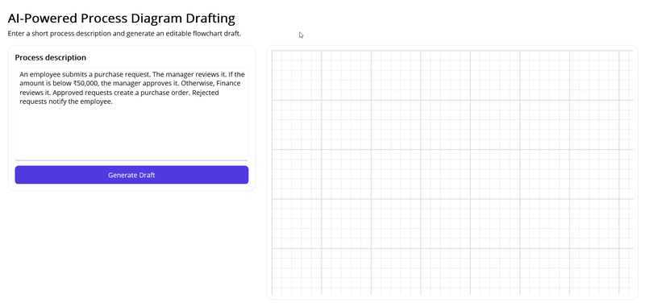

# AI-Powered Process Diagram Drafting

Create editable flowchart drafts from short process descriptions using Syncfusion .NET MAUI Diagram and Azure OpenAI.

## Overview

This sample demonstrates how a single-screen .NET MAUI app can convert a natural-language process description into a structured, editable diagram. The user enters a workflow summary, the app sends it to Azure OpenAI, and the response is validated and rendered as a draft flowchart.

This sample is for teams building AI-assisted workflow tools, process design experiences, or diagramming apps. It helps users move from plain text to an editable draft faster and with less manual diagram creation.

## What the sample does:

- Accepts a short process description from the user
- Sends the description to an AI extraction service
- Converts the AI response into workflow nodes and connectors
- Renders an editable flowchart draft
- Lets the user accept, regenerate, or discard the draft

## Who it is for:

- .NET MAUI developers
- Product teams building workflow or process design tools
- Users who need a fast way to draft process diagrams from plain text

## What AI capability it uses:

- Azure OpenAI structured extraction
- Natural language understanding for workflow parsing
- AI-assisted generation of nodes, connectors, and labels

## What outcome the user gets:

- A draft flowchart that can be reviewed and edited instead of created manually from scratch

## Key Features

- Natural-language process entry
- Structured workflow extraction from Azure OpenAI
- Start, Process, Decision, and End node generation
- Directional connectors with branch labels
- Editable diagram output
- Accept, regenerate, and discard actions
- Warning display for ambiguous or incomplete outcomes

## AI Flow

1. User enters input or triggers the Generate Draft action
2. The app prepares the process description and related context
3. The AI service processes the request and returns structured workflow data
4. The app receives and interprets the response
5. The result is rendered in the diagram UI
6. Optional fallback or retry behavior is applied if the response is incomplete or ambiguous

## Controls Used

- SfDiagram - renders the editable process flowchart
- SfButton - triggers generate, accept, regenerate, and discard actions
- SfEntry or Editor - captures the process description from the user
- SfPopup or SfCardView - displays warnings, guidance, or draft summaries
- SfToolbar - provides quick access to common actions

## Architecture

The sample is built around a simple AI-assisted workflow pipeline.

- View / Page - hosts the input area, draft diagram, and action buttons
- ViewModel - manages user input, AI requests, validation, and UI state
- AI service - sends the prompt to Azure OpenAI and parses the response
- Models - represent nodes, connectors, labels, and validation results
- Supporting UI components - Syncfusion controls that render the input and diagram experience

## Data flow:

- The user enters a process description in the page
- The ViewModel sends the request to the AI service
- The AI service returns structured workflow data
- The ViewModel validates and maps the data into diagram models
- The diagram control renders the draft for user review and editing

## Prerequisites

- .NET 10 SDK
- .NET MAUI workload
- Visual Studio 2022, if using Visual Studio
- Syncfusion .NET MAUI Diagram package and related Syncfusion packages
- Syncfusion license key, if required by your environment
- Azure OpenAI account, endpoint, deployment name, and API key

## AI Configuration

This sample is configured to use Azure OpenAI for workflow extraction.

### Default Behavior

- Real cloud AI service

If configuration is missing, the app should show a clear message and avoid generating a draft until the required settings are provided.

### Environment Variables / Secrets

| Variable | Required | Description |
| --- | --- | --- |
| AZURE_OPENAI_ENDPOINT | yes | Azure OpenAI endpoint or service URL |
| AZURE_OPENAI_API_KEY | yes | Azure OpenAI API key |
| AZURE_OPENAI_DEPLOYMENT | yes | Azure OpenAI deployment name |
| AZURE_OPENAI_MODEL | yes | Azure OpenAI model name |
| AZURE_OPENAI_TIMEOUT_SECONDS | no | Optional request timeout |

### Notes

- Do not commit keys to source control
- Use environment variables, user secrets, or secure storage
- If configuration is missing, describe the fallback behavior in the UI
- Validate AI output before rendering the diagram

## Output

## Project Structure

- Views/ - UI pages and layouts
- ViewModels/ - presentation logic
- Models/ - data structures
- Services/ - AI and helper services
- Resources/ - styles, images, and assets

## Troubleshooting

### Issue 1: Missing AI configuration

Cause:
- Required environment variables or secrets are not set

Fix:
- Add the required configuration values and restart the app

### Issue 2: Build or workload errors

Cause:
- Missing SDK, workload, or incompatible package version

Fix:
- Verify the required .NET version and install the needed MAUI workload

### Issue 3: AI response is unexpected

Cause:
- Prompt, input, or service configuration may be incomplete

Fix:
- Check the prompt and context being sent and confirm the AI settings

## Security and Privacy Notes

- Do not hard-code API keys
- Avoid sending unnecessary sensitive data to the AI service
- Minimize prompt content to only what is needed
- Prefer secure storage for credentials
- Review any external API calls for data exposure

## Supported Platforms

- Android
- iOS
- Windows
- macOS

## License

Add the repository license or vendor disclaimer here.